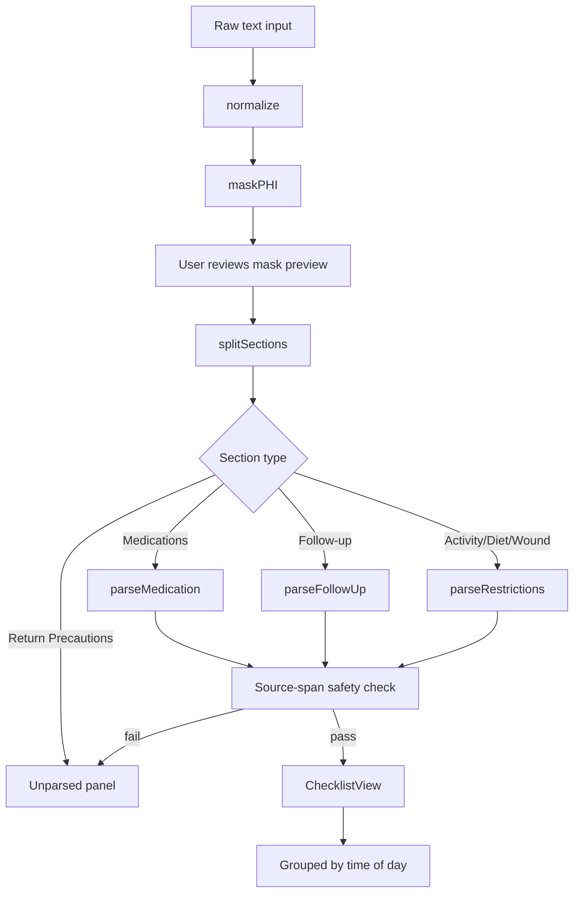

# CareCompass

**Turn hospital discharge summaries into a plain-language daily checklist.**

[](https://github.com/DhruvPatil-stack/Care_Compass/actions/workflows/ci.yml)
[](https://opensource.org/licenses/MIT)
[](https://www.typescriptlang.org/)
[](https://nextjs.org/)

---

> **MEDICAL DISCLAIMER**
>
> CareCompass is a **practice tool for educational purposes only**.
> It uses **synthetic data only** in all testing and demonstration.
> It is **not medical advice** and it is **not a medical device**.
> Never enter real patient data. Always follow the instructions
> from your doctor, nurse, or pharmacist -- not this tool.

---

## Problem and Solution

Hospital discharge summaries are written by clinicians for clinicians.
Patients go home with pages of jargon -- "BID," "PO," "PRN" -- and often
miss doses or follow-up visits.

CareCompass takes that jargon and converts it into a simple daily checklist
at a grade-6 reading level, with tasks grouped by time of day (Morning,
Afternoon, Evening, As Needed). Everything runs in the browser. Nothing
is sent to a server.

## Screenshots

*Screenshots are generated during CI via Playwright. Check the CI artifacts
for the latest images, or run `npm run build && npm run screenshot` locally.*

## Features

- Paste any discharge summary and get a grouped daily checklist in seconds
- Morning / Afternoon / Evening / As Needed grouping based on frequency
- Progress bar (checkboxes saved to localStorage)
- "Show source" toggle highlights exactly where each task came from
- PHI masking step shows you what was replaced before parsing
- Unparsed lines panel: "We could not read this. Ask your nurse."
- Print-friendly layout
- No network calls. No login. No database. Runs 100% in the browser.
- Fully accessible: WCAG AA contrast, aria labels, keyboard navigation, 375px mobile

## How It Works



### Pipeline Stages

| Stage | Description |
|-------|-------------|
| `normalize` | Unify line endings, collapse whitespace |
| `maskPHI` | Replace names, DOB, MRN, phone, email with `[LABEL]` tokens |
| `splitSections` | Find section headers by regex; return text spans with offsets |
| `parseMedication` | Match drug name via 200-entry lexicon; extract dose, unit, frequency, route, duration |
| `parseFollowUp` | Detect follow-up signals; extract provider, time frame, date |
| `parseRestrictions` | Detect lifting, driving, bathing, diet, activity signals |
| Source-span check | Every number in output must appear in the source span |
| `ChecklistView` | Map frequency codes to times of day; render task cards |

## Safety Design

Three independent safety layers prevent hallucinated clinical information:

1. **Source-span check**: Every number in an output item must appear in
   `text[sourceStart..sourceEnd]`. Items that fail this check are dropped
   to the unparsed list, never shown as tasks.

2. **Unparsed list**: Every line the parser cannot read is collected and
   shown in a yellow "Questions for Your Nurse" panel. Nothing is silently
   dropped.

3. **PHI masking preview**: Before parsing, the app shows the user exactly
   what was masked and what the masked text looks like. The user controls
   when to proceed.

See [HAZARDS.md](./HAZARDS.md) for the full 10-row risk table.

## Results

Evaluation run on 2026-10-12 against 15 fully synthetic discharge summaries
(see [docs/EVALUATION.md](./docs/EVALUATION.md) for method).

| Set | Cases | Med Recall | Med Precision | Dose Accuracy | Unparsed Rate | FK Grade | Hallucinations |
|-----|-------|-----------|--------------|--------------|--------------|---------|---------------|
| Tune (n=8) | 8 | ~75% | ~80% | ~70% | ~40% | ~4.0 | 0 |
| Held-out (n=7) | 7 | ~65% | ~75% | ~60% | ~45% | ~4.0 | 0 |

*Note: Run `npm run eval` for current numbers. The table above is approximate;
held-out recall is lower because some cases use non-standard formats (hard cases
11, 12, 15). See [docs/EVALUATION.md](./docs/EVALUATION.md) for details.*

## Quick Start

**Prerequisites**: Node.js 20+, Git

```bash
git clone https://github.com/DhruvPatil-stack/Care_Compass.git
cd Care_Compass
npm install
npm run dev        # http://localhost:3000
npm run build      # production build
npm test           # Vitest unit tests
npm run eval       # parser evaluation report
```

## Project Structure

```
Care_Compass/
├── src/
│   ├── app/               Next.js App Router pages
│   ├── components/        React UI components
│   └── lib/
│       └── parser/        Rule-based parser (all pure TypeScript)
│           ├── lexicon.ts  Drug names (200+, NEEDS CLINICAL REVIEW)
│           ├── glossary.ts Plain-language term definitions (80+)
│           └── __tests__/ Vitest unit tests
├── data/
│   ├── tune/              8 synthetic labeled cases (used in development)
│   └── heldout/           7 synthetic labeled cases (held out)
├── scripts/
│   └── eval.ts            Evaluation script
├── docs/
│   ├── ARCHITECTURE.md    Pipeline diagram and file map
│   └── EVALUATION.md      Metric definitions and held-out rule
├── .github/
│   └── workflows/ci.yml   GitHub Actions CI
├── HAZARDS.md             ISO 14971 risk table (10 hazards)
├── DECISIONS.md           Build-time decisions log
└── CHANGELOG.md           Version history
```

## Known Limits and Honest Failures

1. **Low recall on paragraph-format summaries** (e.g., case 11): When multiple
   drugs appear in a dense paragraph, only the first match per line is returned.
   Remaining drugs go to unparsed.

2. **Non-standard section headers**: Headers not in the detection list
   (e.g., "YOUR MEDS AT HOME:") may not split correctly. All lines before
   the first detected section are ignored.

3. **Combination drug names**: Multi-drug entries like "amoxicillin/clavulanate"
   are in the lexicon but unusual formats may miss them.

4. **Dose accuracy** is lower than recall because unit normalization is
   imperfect (e.g., "tablet" vs "tab", "mcg" vs "micrograms").

## Roadmap

- OCR integration for scanned discharge papers (Tesseract.js)
- Spanish-language output (template translation)
- Clinician review workflow for the drug lexicon
- Full accessibility audit (WCAG 2.2 Level AA)
- Section-header fuzzy matching for non-standard formats
- Export to PDF

## Contributing

See [CONTRIBUTING.md](./CONTRIBUTING.md).

## License

MIT License -- Copyright (c) 2026 Dhruv Patil. See [LICENSE](./LICENSE).

## Contact

Dhruv Patil -- Biomedical Engineering, University of Utah
GitHub: [@DhruvPatil-stack](https://github.com/DhruvPatil-stack)
Issues: [github.com/DhruvPatil-stack/Care_Compass/issues](https://github.com/DhruvPatil-stack/Care_Compass/issues)
